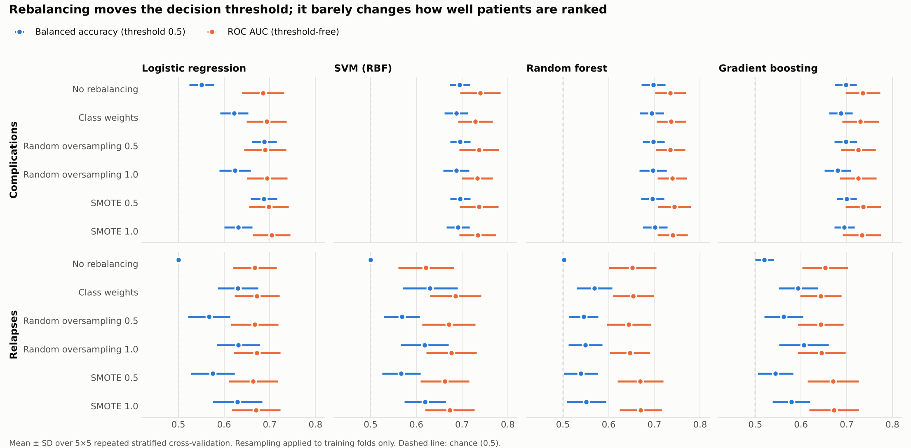

# Predicting complications and relapses after haemorrhoid surgery

Code and results for my MSc thesis in Mathematical Engineering at the University of L'Aquila
(December 2024), on clinical data from an Italian hospital shared through SICCR, the Italian
Society of Colorectal Surgery.
Supervisor: Dr. Andrea Manno. Co-supervisor: Prof. Fabrizio Rossi.

**[Read the thesis (PDF)](thesis/Abdoulie_J_Bah_MSc_Thesis_2024.pdf)**

## The question

Can pre-operative and procedural information predict which patients will have a complication
or a relapse after haemorrhoid surgery? Both outcomes are rare, so most of the work is about
training and evaluating models on imbalanced clinical data without fooling yourself: on the
relapse data, a model that predicts "no relapse" for everyone is 91% accurate and useless.

## Data (not included in this repository)

| Task | Patients | Positive cases |
|---|---|---|
| Complications (yes/no) | 1,726 | 275 (15.9%) |
| Relapses (yes/no) | 1,250 | 116 (9.3%) |

Features: age, sex, haemorrhoid prolapse, type of intervention, surgical tool and technique
(Ligasure, Focus, diathermy), type of anaesthesia, pre-operative bleeding, manual reduction,
pain/discomfort, and a pre-operative total symptom score. Age outliers were removed with the
IQR rule and features were min-max scaled to [0, 1]. The relapse cohort is smaller because
rows with missing values were excluded.

The data are hospital records and are not public. `postop/data.py` generates a synthetic
dataset with the same columns and class balance so that all the code runs without them.

## What the thesis did (2024)

- Four tasks: complications and relapses, each as binary and multiclass (severity grade).
  The multiclass versions were dropped: the higher grades were too rare to learn.
- Seven models: logistic regression, SVM, k-NN, naive Bayes, random forest, gradient
  boosting and XGBoost, tuned with grid search and 5-fold cross-validation.
- Oversampling of the minority class in the training set (SMOTE and random oversampling)
  at ratios from 40% to 100%, evaluated on a stratified 20% hold-out set.

On the hold-out set (346 patients with 55 complications; 250 patients with 23 relapses):

- **Complications.** Without rebalancing, logistic regression caught only 9% of complications
  (balanced accuracy 0.54); with oversampling it caught 62% (0.75). Gradient boosting and
  random forest reached 0.74 without any rebalancing.
- **Relapses.** Without rebalancing, most models predicted "no relapse" for everyone (0.50).
  The best result, logistic regression with full oversampling, caught 65% of relapses
  (balanced accuracy 0.66).

## Re-analysis (2026)

A single 80/20 split with 55 or 23 positive patients gives noisy numbers. Coming back to the
work, I re-ran the core comparison more carefully:

- 5×5 repeated stratified cross-validation, so every number has a spread;
- every resampling step inside the training folds only;
- SMOTE vs random oversampling vs class weights, at ratios 0.5 and 1.0;
- a threshold-free metric (ROC AUC) next to balanced accuracy.



What it shows:

1. **Complications are moderately predictable.** ROC AUC is 0.72–0.74 for SVM, random
   forest and gradient boosting (0.68–0.70 for logistic regression), and balanced accuracy is
   0.68–0.70 with a fold-to-fold SD of 0.02–0.03. The thesis hold-out figures (0.74–0.75)
   were on the optimistic side: a single split with 55 positive patients can land there.
2. **Rebalancing changes the operating point, not the model's ability to rank patients.**
   For complications, each model's ROC AUC moves by at most 0.02 across all strategies.
   What changes is the trade-off: random
   forest without rebalancing flags 41% of complications at 88% precision; with SMOTE at 1.0
   it flags 48% at 55% precision. Where to sit on that curve is a clinical choice (the cost of
   a missed complication against an unnecessary follow-up), and it is clearer to make it by
   setting the decision threshold explicitly.
3. **Logistic regression is where rebalancing matters at the default threshold**: balanced
   accuracy goes from 0.55 to 0.69, because without it the model almost never predicts a
   complication.
4. **SMOTE and random oversampling perform about the same here.** At the same ratio they
   differ by 0.03 or less in balanced accuracy, usually by under 0.01, inside the
   fold-to-fold spread (SD 0.02–0.05). Class weights behave like oversampling to a 1:1 ratio.
5. **Relapses are hard to predict from pre-operative variables.** ROC AUC is 0.62–0.69 and
   the best balanced accuracy is 0.63 (logistic regression or SVM with class weights or full
   oversampling), with precision around 15%. The limit looks like the information in the features, not the method.

Full results, including recall, precision and PR AUC per fold, are in [`results/`](results/).
Notes: hyperparameters are fixed in the re-analysis (no grid search); the features were
min-max scaled on the whole dataset before splitting, as in the thesis pipeline, which only
affects the input scale of logistic regression and SVM.

## What I would do next

- Choose the decision threshold with clinicians instead of tuning the oversampling ratio, and
  check calibration.
- Use SMOTE-NC: plain SMOTE interpolates the binary features to values between 0 and 1.
- Permutation importance or SHAP to see which pre-operative factors drive the risk.
- External validation on patients from another hospital.

## Run it

```bash
pip install -r requirements.txt
python run_experiments.py --synthetic      # about 4 minutes on 2 cores
python make_figures.py --synthetic
python -m unittest discover tests
```

With access to the study data: `python run_experiments.py --data-dir <folder>`
(see [`data/README.md`](data/README.md)).

## Repository

| Path | Contents |
|---|---|
| `thesis/` | The thesis as submitted, December 2024 |
| `postop/data.py` | Loading the study data; synthetic stand-in data |
| `postop/resampling.py` | Random oversampling and SMOTE, written out in a few lines |
| `postop/evaluate.py` | Models, imbalance strategies, repeated cross-validation |
| `run_experiments.py`, `make_figures.py` | Entry points |
| `results/` | Cross-validation results on the study data (aggregate metrics only) |

## License

Code: MIT (see `LICENSE`). Thesis PDF: © Abdoulie J Bah, all rights reserved.
